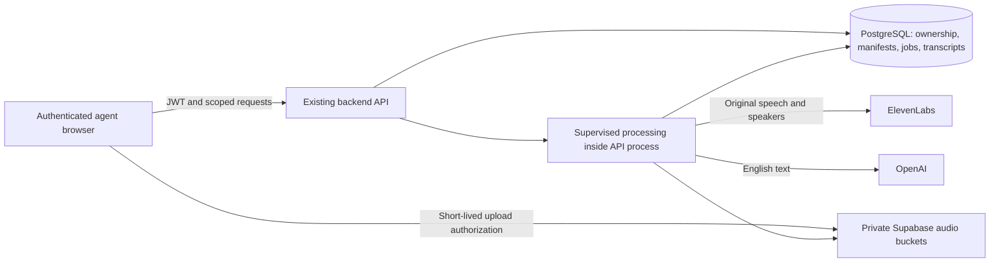

# Recording implementation and rollout — 27 October 2026

This document records implementation on `dev` and local verification. Deployment and hosted migrations were not performed by this agent. Tests use synthetic customers, disposable databases and mocked providers. They do not establish live speech accuracy, latency or account quota capacity.

Subsequently supplied Render logs show the embedded processing runtime deployed and running. See [Storage incident diagnosis and local follow-up fixes](STORAGE_TROUBLESHOOTING.md) for the live failure evidence and remaining validation. Those follow-up fixes have not been deployed by this agent.

## Runtime and storage

There are two Render services in `render.yaml`: frontend and backend. Processing is a supervised asyncio task in the backend lifespan, using durable database jobs and distinct process lease identities. Restarting an API does not erase queued work. Submitted provider requests with an uncertain outcome are held for reconciliation. Shutdown has a bounded drain/cancellation deadline.

New browser capture/upload chunks default to 10 seconds. Valid legacy chunks up to 180 seconds are accepted for recovery. Playback streams verified saved chunks without waiting for a full-recording assembly job. MP3 encoding concurrently writes input and drains both output pipes; disconnects cancel input and reap FFmpeg.

Hosted audio lives in private `session-audio` or `walkin-audio` buckets, with manifests and ownership in PostgreSQL. Provider artifacts use `recorder-artifacts`. Local development uses `backend/.local-data/guruconnect.sqlite3` and UUID-scoped audio directories. Unsent recovery data lives in browser IndexedDB. Local mode has one loopback-only account and is not a multi-user SaaS deployment.

Deletion immediately hides a conversation and fences processing; durable cleanup removes its physical objects and transcript data. Maintenance runs independently of slow provider calls. Provider outages do not require running another service to execute retention or deletion.

## Implemented controls

- Sales/voice routes verify the parent API's login token and active workspace membership. Identity headers cannot establish a login. Customer/session/note/recording links enforce matching workspace, member and customer.
- Ordinary saves enable source transcription and English translation. Original text, speakers and English results remain attached to their own conversation/run/version.
- Recorder/recovery state is scoped by account, workspace and selected member. Unmount and customer changes dispose capture; late requests cannot populate a different customer's view. Owners reviewing another member cannot capture as that member.
- Platform keys are read from `ELEVENLABS_API_KEY` and `OPENAI_API_KEY` in the backend environment. They are not sent to browsers or copied to provider-secret rows. The provider status panel is hidden from account Settings; session processing status and retry controls remain available. Removing a server key makes managed configuration unavailable; reading settings preserves actual provider failures.
- Translation uses `OPENAI_TRANSLATION_MODEL`, falling back to `OPENAI_MODEL`. The existing `gpt-4o-mini` configuration is supported.
- Default provider and processing concurrency is four. Uploads remain independent of processing admission. Provider credential scopes apply shared limits across workspaces using the same server key.
- Local playback/download/delete endpoints are implemented. Enquiry detail retains saved customer fields and its recording link. Walk-in conversion reuses the registration ticket and preserves its public tracking token and ticket number. Receptionists can attach their own saved registration audio after assignment to a salesperson; the audio retains its owner and access scope.
- GitHub workflows and dependency configuration live at repository root, with corrected frontend/backend paths. The container includes the mounted sales application.

## Verification evidence

Completed during this implementation:

| Check | Result |
| --- | --- |
| Frontend component/unit tests | 168 passed across 21 files; no skipped tests |
| Actual Chrome browser workflows | All 8 passed together: microphone/pause/resume/save/playback, WAV upload/reload/MP3 download, invalid-file rejection, navigation protection, mobile navigation, walk-in conversion, reload recovery and account-scoped recovery |
| Frontend TypeScript and build | Passed |
| Production build with synthetic hosted public configuration | Passed; exact-origin CSP and hosted authentication validated |
| Complete backend Python suite | 545 passed in the final run, including native database/API regressions |
| Release configuration scripts | 11 passed |
| Real FFmpeg/audio, history pagination and API runtime tests | Passed; includes long output backpressure, client disconnect, automatic mocked Hindi→English and physical deletion |
| Readiness across partial/full migration states | 42 passed |
| Native SQL invariants | 102 security, 27 OpenAI, 17 walk-in and 9 sales-session assertions passed |
| Native database concurrency | 20 clients / 1 workspace and 100 clients / 20 workspaces; zero duplicate publications |
| Native API recording concurrency | 20 simultaneous agents; separate customers/conversations, successful transcripts/playback, peer reads denied; real queue bounded to four simulated provider calls |
| Ruff E9/F and generated API contracts | Passed |
| Production npm dependency audit | Zero reported vulnerabilities |

The SQL concurrency test emulates database operations, not Storage HTTP or speech inference. The API concurrency test uses in-memory private storage and synthetic ASR. The local lifecycle test simulates ElevenLabs and OpenAI. These checks complement each other; none measures live Render/provider throughput.

## Deployment steps and remaining validation

1. Back up production PostgreSQL and private Storage. Apply all pending migrations in lexical order, including `202610260002_managed_translation_models.sql`, `202610260003_sales_session_scope.sql` and `202610260004_recording_owner_access.sql`. Do not edit historical applied migrations. New scoped constraints enforce writes without exposing legacy unscoped records; any required legacy data repair needs a reviewed mapping to the correct tenant and owner.
2. Set the backend provider keys, keep the existing `OPENAI_MODEL` if desired, and set `EMBEDDED_PROCESSING_ENABLED=true`. Start with processing/provider concurrency four and request concurrency 64. Retain exact production CORS and verified JWT configuration. The Blueprint proposes 1 CPU / 2 GB for the combined backend; this is a capacity starting point, not a measured service-level guarantee.
3. Deploy matching backend and frontend revisions from the intended branch. Existing Render services are not automatically changed by editing this repository. Confirm `/ready` is healthy; it checks the final migration and embedded processing supervisor.
4. Exercise consented non-English recordings under two real logins, account/workspace switching, recovery after a network interruption, source playback, MP3 download, restart recovery, retention and deletion. Verify Supabase Storage policy behavior and ElevenLabs/OpenAI request results with your actual project permissions.
5. Run a staging load test with 20 active agents, realistic recording duration, simultaneous finalization and slow providers. Measure upload latency, queue age, provider 429s, memory/CPU, database connections and response latency. Increase concurrency only within measured backend headroom and provider quotas. Twenty recording sessions do not imply twenty simultaneous inference calls or guaranteed real-time translation.

A pre-existing migration, `20261013000002_ensure_zoho_refresh_cron.sql`, contains a committed Zoho refresh cron credential. Rotate the deployed backend/Vault value and revoke that exposed value before production approval; historical migration checksums and repository history need coordinated handling. No secret value is reproduced here. This implementation has not changed live credentials or erased repository history.

Production sign-off also requires a restore drill, retention-policy verification, tenant access review and live provider/load validation. Passing local tests is not an enterprise/SaaS certification.
